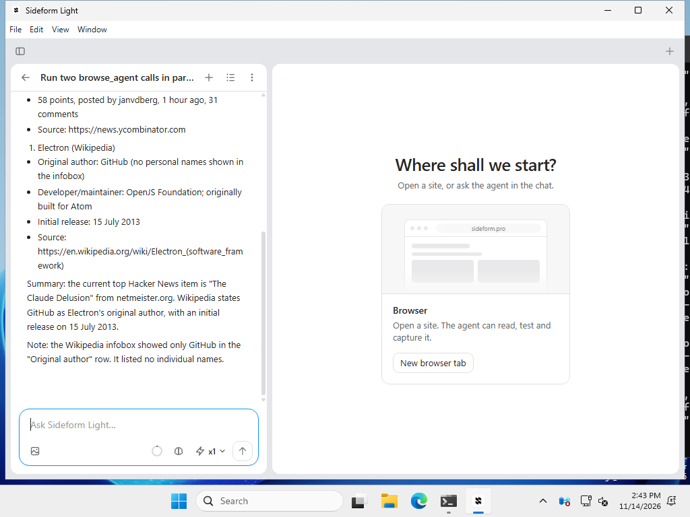

# Sideform Light

An AI agent chat on the left, a built-in browser on the right. Ask the agent to open a site, read it,
test it or sign in with a saved login. It drives real browser tabs and can run several isolated
browser sessions in parallel.

## Download

Get the installer from the [latest release](https://github.com/dan-rozhkov/sideform-light/releases/latest):

- **Windows:** `Sideform Light Setup <version>.exe`. The installer is not signed. Windows SmartScreen
  shows a warning: click **More info → Run anyway**.
- **macOS:** `.dmg`. The app is not notarized. On first start, right-click the app and select **Open**.

## Code signing policy

Free code signing provided by [SignPath.io](https://about.signpath.io), certificate by [SignPath Foundation](https://signpath.org).

- Committers and reviewers: [dan-rozhkov](https://github.com/dan-rozhkov)
- Approvers: [dan-rozhkov](https://github.com/dan-rozhkov)

Every release is built from this repository by GitHub Actions (`.github/workflows/release.yml`) and is
signed only after manual approval. Privacy policy: [PRIVACY.md](PRIVACY.md). The Windows installer shows it
before installation.

## Privacy

Your chats, saved logins, history and traces stay on your computer. The backend runs inside the app; the
page content and your messages leave your computer only for the model provider you configure. See [PRIVACY.md](PRIVACY.md).

## Windows

Sideform Light 0.1.1 on Windows 11, installed from the release `.exe` on a GitHub Actions runner
(`.github/workflows/windows-smoke.yml`). The agent ran two browser sessions in parallel through the production backend.




## Layout

- `app/` — the Electron shell (tabs, browser, passwords, history, ad blocking). See `app/README.md`.
- `ui/` — the agent panel, trace page and settings page (Vite + React), bundled into the app.
- `CONTRACT.md` — the integration contract between the two and the backend.

## Build

The app bundles the backend ([pen-editor-backend](https://github.com/dan-rozhkov/pen-editor-backend), local build)
and runs it on your machine. You set your own model provider in Settings > Model.

```bash
(cd ui && npm ci && npm run build)
# the backend repo: npm ci && npm run build:local  ->  dist-local/
cd app && npm ci && SIDEFORM_LIGHT_BACKEND_BUNDLE=/path/to/pen-editor-backend/dist-local npm start
```

Without `SIDEFORM_LIGHT_BACKEND_BUNDLE` the build warns and the app runs without a backend; packaging
(`npm run dist`) fails. `SIDEFORM_LIGHT_SKIP_BACKEND=1` skips the bundle silently (CI, e2e).

For development, run the backend yourself and point the shell at it:

```bash
# in pen-editor-backend
npm run dev:local                      # http://localhost:3001
# here
SIDEFORM_LIGHT_BACKEND_URL=http://localhost:3001 npm --prefix app start   # the shell forwards /api/* there
scripts/dev-prod.sh                    # ui dev server (hot reload) + Electron, backend on :3001
```

`BACKEND_URL=http://localhost:3002 scripts/dev-prod.sh` uses another port. Chats of the dev mode go to `chats-dev/`.

Releases are built by `.github/workflows/release.yml` on a `v*` tag. It builds the backend bundle from the commit
pinned in `backend-ref.txt` (one 40-character SHA of pen-editor-backend).

## License

MIT, see [LICENSE](LICENSE).
