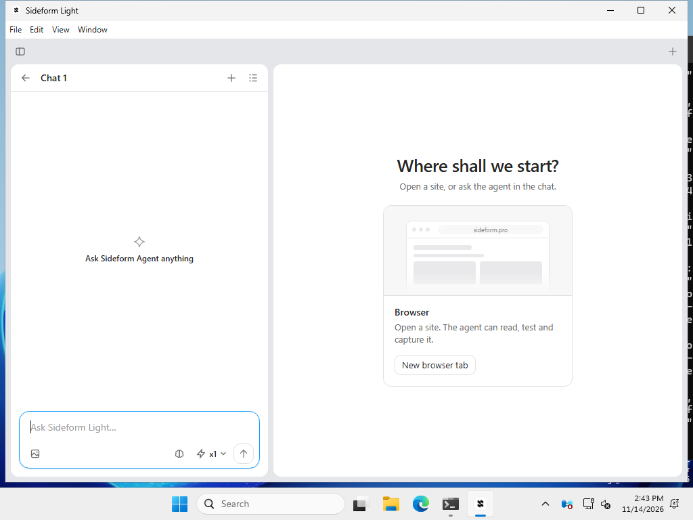

# Sideform Light

An AI agent chat on the left, a built-in browser on the right. Ask the agent to open a site, read it,
test it or sign in with a saved login. It drives real browser tabs and can run several isolated
browser sessions in parallel.

## Download

Get the installer from the [latest release](https://github.com/dan-rozhkov/sideform-light/releases/latest):

- **Windows:** `Sideform Light Setup <version>.exe`. The installer is not signed. Windows SmartScreen
  shows a warning: click **More info → Run anyway**.
- **macOS:** `.dmg`. The app is not notarized. On first start, right-click the app and select **Open**.

Your data (saved logins, history, chats, traces) stays on your computer. The app sends only agent
requests to the Sideform backend.

## Windows

Sideform Light 0.1.1 on Windows 11, installed from the release `.exe` on a GitHub Actions runner
(`.github/workflows/windows-smoke.yml`). The agent ran two browser sessions in parallel through the production backend.




## Layout

- `app/` — the Electron shell (tabs, browser, passwords, history, ad blocking). See `app/README.md`.
- `ui/` — the agent panel, trace page and settings page (Vite + React), bundled into the app.
- `CONTRACT.md` — the integration contract between the two and the backend.

## Build

```bash
(cd ui && npm ci && VITE_DESIGN_AGENT_BACKEND_URL=http://localhost:3001 npm run build)
cd app && npm ci && SIDEFORM_LIGHT_BACKEND_URL=http://localhost:3001 npm start
```

Both backend URLs must be the same. Releases are built by `.github/workflows/release.yml` on a `v*` tag.
